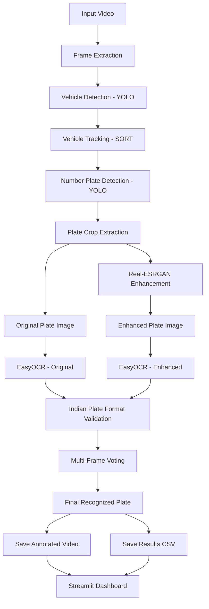

# 🚗 Video-ANPR: Automatic Number Plate Recognition Using Real-ESRGAN and OCR

## 📌 Project Overview

**Video-ANPR** is a computer vision project that automatically detects vehicles, identifies their number plates, enhances plate images, and recognizes vehicle registration numbers from video footage.

The system combines object detection, vehicle tracking, image enhancement, Optical Character Recognition (OCR), and multi-frame voting to improve number plate recognition.

It also provides a **Streamlit dashboard** to visualize the processed video, recognized number plates, tracking information, and OCR evaluation results.

### 🎯 Project Objectives

- Detect vehicles in video frames.
- Track vehicles across multiple frames using SORT.
- Detect and extract vehicle number plates.
- Enhance low-quality number plate images using Real-ESRGAN.
- Recognize number plate characters using EasyOCR.
- Validate recognized numbers using Indian vehicle registration format rules.
- Apply multi-frame voting to improve recognition consistency.
- Evaluate OCR performance using manually verified ground-truth labels.
- Display the results through an interactive Streamlit dashboard.

---

## 🏗️ System Architecture

The project follows a sequential processing architecture.

### Overall Architecture



### Architecture Explanation

| Stage | Component | Description |
|---|---|---|
| 1 | Input Video | Takes the input video for processing. |
| 2 | Frame Extraction | Extracts individual frames using OpenCV. |
| 3 | Vehicle Detection | YOLO detects vehicles in each frame. |
| 4 | Vehicle Tracking | SORT tracks vehicles and assigns unique IDs. |
| 5 | Plate Detection | Detects number plates in the video frames. |
| 6 | Plate Cropping | Extracts the detected number plate region. |
| 7 | Image Enhancement | Real-ESRGAN enhances the cropped plate image. |
| 8 | OCR Recognition | EasyOCR extracts text from original and enhanced images. |
| 9 | Plate Validation | Checks whether recognized text follows the expected Indian registration format. |
| 10 | Multi-Frame Voting | Combines recognition results across frames for the same tracked vehicle. |
| 11 | Result Generation | Saves the final video and CSV results. |
| 12 | Dashboard | Displays the processed results and evaluation metrics. |

---

## 🔄 How the System Works

### 1. Input Video and Frame Extraction

The system accepts a video as input.

OpenCV reads the video and extracts frames for further processing.

### 2. Vehicle Detection Using YOLO

YOLO (You Only Look Once) is used to identify vehicles in each frame.

The model detects vehicle regions and generates bounding boxes.

### 3. Vehicle Tracking Using SORT

SORT (Simple Online and Realtime Tracking) tracks detected vehicles across consecutive frames.

Each tracked vehicle receives a unique ID.

For example:

- Vehicle 1 → ID 1
- Vehicle 2 → ID 2
- Vehicle 3 → ID 3

These IDs help associate number plate observations with the same tracked vehicle.

### 4. Number Plate Detection

A number plate detection model identifies the registration plate region of each vehicle.

The detected plate bounding box is used to extract the plate image.

### 5. Plate Crop Extraction

The detected number plate region is cropped from the original video frame.

The cropped images are stored in:

```text
outputs/plate_crops/
```

### 6. Image Enhancement Using Real-ESRGAN

Real-ESRGAN is used to enhance the cropped number plate images.

It attempts to improve image quality and visibility, especially when the original plate image has limited resolution.

Enhanced images are stored in:

```text
outputs/enhanced_plates/
```

**Note:** Image enhancement cannot guarantee recovery of characters that are missing or completely unreadable in the original image.

### 7. Text Recognition Using EasyOCR

OCR stands for **Optical Character Recognition**.

EasyOCR extracts letters and numbers from number plate images.

The system can process:

- Original plate images.
- Enhanced plate images.

This allows comparison between OCR results before and after enhancement.

### 8. Indian Number Plate Validation

The recognized text is checked against the expected Indian vehicle registration number format.

Validation helps reject incorrectly formatted OCR predictions.

The validation rules are implemented in the plate utility functions.

### 9. Multi-Frame Voting

Sometimes OCR produces different predictions for the same vehicle in different frames.

Multi-frame voting combines observations associated with the same tracked vehicle ID.

The most consistently recognized valid plate candidate can be selected as the final result.

This helps reduce recognition errors, although it does not guarantee a correct result.

### 10. Result Generation

After processing, the system saves:

- Annotated output video.
- Number plate crops.
- Enhanced number plate images.
- OCR and tracking results in CSV format.
- Evaluation results.

### 11. Streamlit Dashboard

The dashboard loads the generated results and presents them in an easy-to-understand interface.

It can be used to view:

- Processed output video.
- Vehicle tracking information.
- Number plate observations.
- Recognized registration numbers.
- OCR confidence information.
- OCR accuracy comparison.

---

## 📁 Project Folder Structure

```text
Video-ANPR/
│
├── main.py
├── app.py
├── utils.py
├── plate_utils.py
├── fill_ground_truth.py
├── create_contact_sheets.py
├── README.md
├── requirements.txt
│
├── models/
│   └── vehicle and plate detector weights
│
├── weights/
│   └── enhancement model weights
│
├── sort/
│   ├── sort.py
│   └── sort-master/
│
├── scripts/
│   ├── evaluate_ocr_accuracy.py
│   ├── check_ground_truth.py
│   ├── test_ocr_config.py
│   ├── test_plate_validation.py
│   ├── test_preprocessing.py
│   ├── test_voting.py
│   └── verify_deliverables.py
│
├── data/
│   ├── test.csv
│   └── ground_truth_current_run.csv
│
└── outputs/
    ├── plate_crops/
    ├── enhanced_plates/
    ├── evaluation/
    ├── anpr_realesrgan_output.mp4
    └── anpr_realesrgan_results.csv
```

### Important Files and Their Responsibilities

| File | Responsibility |
|---|---|
| `main.py` | Executes the complete Video-ANPR processing pipeline. |
| `app.py` | Runs the Streamlit dashboard. |
| `utils.py` | Contains reusable helper functions. |
| `plate_utils.py` | Contains number plate processing, OCR-related and validation utilities. |
| `fill_ground_truth.py` | Helps populate ground-truth plate labels. |
| `create_contact_sheets.py` | Creates contact sheets for visual inspection of plate crops. |
| `sort/sort.py` | Implements vehicle tracking. |
| `scripts/evaluate_ocr_accuracy.py` | Evaluates OCR recognition performance. |
| `scripts/check_ground_truth.py` | Checks ground-truth data. |
| `scripts/test_ocr_config.py` | Tests OCR configurations. |
| `scripts/test_plate_validation.py` | Tests number plate validation. |
| `scripts/test_preprocessing.py` | Tests image preprocessing. |
| `scripts/test_voting.py` | Tests multi-frame voting. |
| `scripts/verify_deliverables.py` | Checks required project output files. |

---

## 🛠️ Technologies Used

| Technology | Purpose |
|---|---|
| Python | Main programming language |
| YOLO | Vehicle and number plate detection |
| SORT | Vehicle tracking |
| OpenCV | Video processing and frame extraction |
| Real-ESRGAN | Number plate image enhancement |
| EasyOCR | Text recognition |
| PyTorch | Deep learning framework |
| NumPy | Numerical operations |
| Pandas | CSV processing and evaluation |
| Streamlit | Interactive dashboard |

---

## ⚙️ Installation and Setup

### Prerequisites

Install the following before running the project:

- Python (a version supported by the selected model libraries)
- pip
- Git (optional)
- Required model weights
- Input video

### Step 1: Clone the Repository

```bash
git clone https://github.com/lakshanadevi70
```

Move into the project directory:

```bash
cd Video-ANPR
```

### Step 2: Create a Virtual Environment

```bash
python -m venv venv
```

Activate it on Windows:

```powershell
venv\Scripts\activate
```

On Linux or macOS:

```bash
source venv/bin/activate
```

### Step 3: Install Dependencies

```bash
pip install --upgrade pip
```

Install project dependencies:

```bash
pip install -r requirements.txt
```

**Important:** Real-ESRGAN and BasicSR may require compatible dependency versions. Follow the environment requirements used by your working project setup.

### Step 4: Configure Model Weights

Place the required model files in their respective directories:

```text
models/
    vehicle_detector.pt
    plate_detector.pt

weights/
    realesrgan_model.pth
```

The filenames above are examples. Use the actual filenames expected by your code.

### Step 5: Configure Input Video

Place your authorized test video in the location configured in `main.py`.

Check that the input video path and model weight paths are correct before execution.

---

## ▶️ How to Run the Project

The project has two main execution stages.

### Stage 1: Run the ANPR Pipeline

Execute:

```bash
python main.py
```

This starts the processing pipeline:

1. Reads the input video.
2. Extracts video frames.
3. Detects vehicles using YOLO.
4. Tracks vehicles using SORT.
5. Detects number plates.
6. Extracts number plate crops.
7. Enhances plate images using Real-ESRGAN.
8. Recognizes text using EasyOCR.
9. Validates recognized plate numbers.
10. Applies multi-frame voting.
11. Saves the annotated video and CSV results.

### Stage 2: Inspect Number Plate Crops

Generate contact sheets:

```bash
python create_contact_sheets.py
```

Inspect the plate images and manually verify readable number plates.

### Stage 3: Verify Ground Truth

Run:

```bash
python scripts/check_ground_truth.py
```

Check the ground-truth file:

```text
data/ground_truth_current_run.csv
```

Use manually verified labels. Do not copy OCR predictions into the ground-truth column without checking the original footage.

### Stage 4: Evaluate OCR Accuracy

Run:

```bash
python scripts/evaluate_ocr_accuracy.py
```

The evaluation compares:

- Original OCR recognition.
- Enhanced OCR recognition.
- Multi-frame voting results.

For a fair comparison, use the same video run and the same verified ground-truth observations for all three methods.

### Stage 5: Verify Deliverables

```bash
python scripts/verify_deliverables.py
```

This checks whether the expected project output files are available.

### Stage 6: Launch the Dashboard

Run:

```bash
streamlit run app.py
```

Streamlit will display a local URL in the terminal. Open that URL in your browser to view the dashboard.

---

## 📊 OCR Evaluation

The project evaluates recognition performance using manually verified ground-truth labels.

### Evaluation Methods

| Method | Description |
|---|---|
| Original OCR | Recognition directly from the original plate crop. |
| Enhanced OCR | Recognition from the Real-ESRGAN-enhanced crop. |
| Multi-Frame Voting | Final plate prediction obtained by combining observations across frames. |

### Evaluation Metrics

**1. Exact-Match Accuracy**

Measures the percentage of predictions that exactly match the verified number plate.

```text
Exact-Match Accuracy =
(Number of Exact Matches / Total Evaluated Observations) × 100
```

**2. Character Accuracy**

Measures the proportion of correctly recognized characters.

**3. Precision**

Measures how many positive predictions are correct, according to the evaluation definition used.

**4. Recall**

Measures how many actual positive cases are correctly identified.

**5. F1-Score**

Balances precision and recall.

**6. Processing Time**

Measures the time required to process the video or individual observations, depending on the evaluation method.

**Important:** Report the number of verified and matched observations along with every accuracy percentage. A small sample must not be presented as full-project performance.

---

## 📂 Output Files

After running the pipeline, the `outputs/` directory contains the generated results.

| Output | Description |
|---|---|
| `plate_crops/` | Original cropped number plate images. |
| `enhanced_plates/` | Enhanced number plate images. |
| `evaluation/` | Evaluation reports and related files. |
| `anpr_realesrgan_output.mp4` | Annotated processed video. |
| `anpr_realesrgan_results.csv` | Recognition, tracking and processing results. |

---

## 🧪 Testing

The project includes separate scripts for testing important components.

Run them individually:

```bash
python scripts/test_ocr_config.py
python scripts/test_plate_validation.py
python scripts/test_preprocessing.py
python scripts/test_voting.py
```

These scripts help verify the individual processing components during development.

---

## ⚠️ Limitations

- Poor-quality video can reduce vehicle and number plate detection performance.
- Very small or blurry plate crops can reduce OCR accuracy.
- Real-ESRGAN cannot reliably reconstruct characters that are not visible in the original image.
- Vehicle tracking may produce incorrect IDs during occlusion or when vehicles leave and re-enter the scene.
- Incorrect plate detection can affect the final OCR output.
- Multi-frame voting depends on correct vehicle tracking and consistent observations.
- Indian number plate validation rules may not cover every special registration format.
- Processing time depends on video resolution, video duration, hardware and model configuration.

---

## 🚀 Future Enhancements

- Improve number plate detection accuracy.
- Experiment with better preprocessing methods.
- Improve OCR performance on low-resolution plate images.
- Introduce more robust tracking methods.
- Improve multi-frame voting and confidence-based selection.
- Expand Indian number plate format support.
- Add more detailed evaluation and visualization.
- Optimize processing speed for real-time applications.

---

## 🔐 Responsible Use

This project is intended for educational and research purposes using authorized video footage.

Use the system in compliance with applicable privacy laws and obtain appropriate permission before processing identifiable vehicle information.

---

## 👩‍💻 Project Summary

**Video-ANPR** integrates object detection, tracking, image enhancement and OCR into one automated number plate recognition pipeline.

By combining YOLO, SORT, Real-ESRGAN, EasyOCR and multi-frame voting, the project aims to improve the recognition of vehicle registration numbers from video footage.

The Streamlit dashboard provides a simple way to visualize the generated results and evaluate system performance.

---

**Project:** Video-Based Automatic Number Plate Recognition (Video-ANPR)  
**Domain:** Artificial Intelligence and Computer Vision  
**Primary Language:** Python  
**Dashboard:** Streamlit  
**Status:** Academic / Research Project